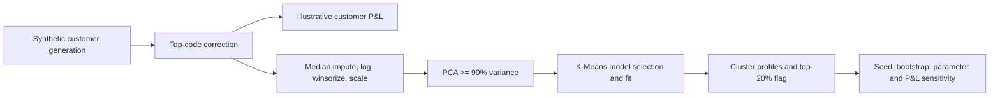
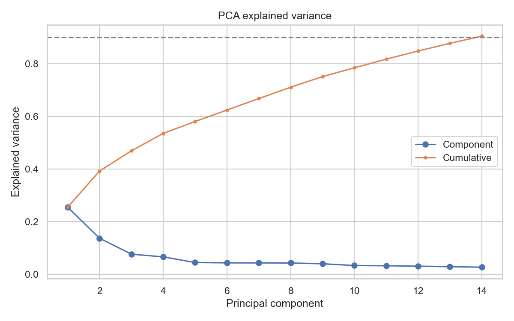
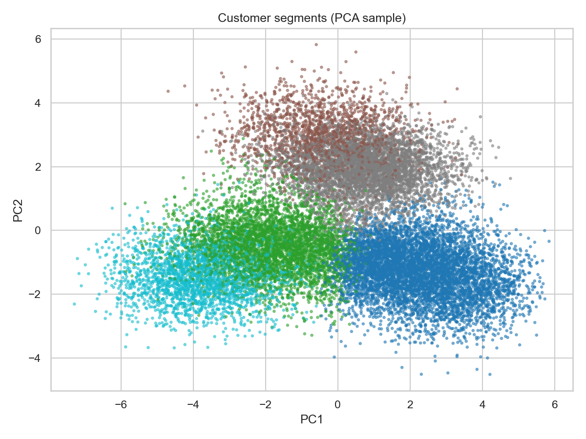
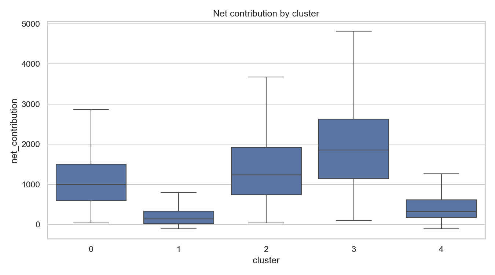
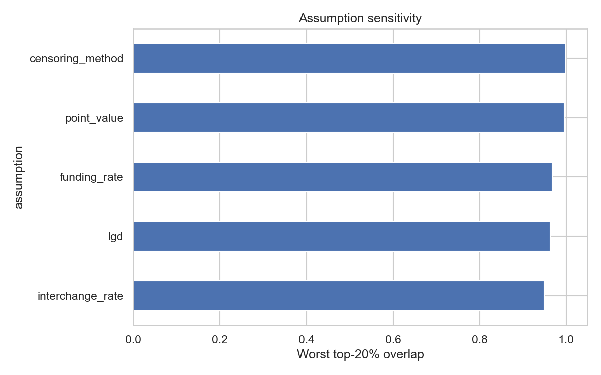

# AmEx Strategy Challenge | Profitability Segmentation Model

An end-to-end unsupervised segmentation workflow combines customer feature engineering, corrected top-coded measures, a transparent illustrative customer P&L, PCA, K-Means, cluster profiling and stability analysis. The chosen k maximizes silhouette within the documented business range k=4–8.

> **Synthetic data disclaimer:** The challenge data is proprietary and unavailable. Every customer and financial value in this repository is synthetic, generated from seeded distributions. Reported numbers illustrate the method only and are not real AmEx results.

## Problem
Identify groups of credit-card customers with distinct behavioral and profitability profiles, and flag the most profitable fifth of customers for strategic study. P&L components are excluded from clustering inputs to avoid target leakage.

## Method



### P&L equation

`net contribution = interest income + interchange income + fee income − rewards cost − credit loss − cost of funds − servicing cost − acquisition cost amortized`.

Rates, PD coefficients, payment adjustment, component noise levels and other P&L assumptions are centralized in `config.yaml`. Expected credit loss is modeled as balance × a score/late-payment/utilization-based PD × LGD. Components include multiplicative noise in the generated input data; the pipeline recalculates P&L consistently from the feature definitions.

### Censoring correction

Three inputs are top-coded at configured reporting caps. A generalized Pareto tail fitted to the uncensored upper tail estimates the conditional mean above each cap, bounded by a fitted 99.9th percentile. Original values and censor flags remain available; corrected values are added in separate columns.

## Run

```bash
make setup
make all
# Or: .venv/bin/python -m src.run_pipeline --n-customers 120000 --seed 42
```

The default generator produces 120,000 records and 23 modeling features. An explicit smaller count is supported for smoke runs. Outputs are written under `outputs/`; data is regenerated under `data/`.

## Results

The pipeline writes the actual metrics for the run to `outputs/tables/run_summary.csv`, cluster profiles to `cluster_profiles.csv`, and all sensitivity tables alongside them. This README's figures embed the generated figures below; numeric outcomes are populated after running the pipeline and must be read from the generated summary rather than treated as published real-world estimates.

| Metric | Run result |
|---|---:|
| Customers / modeling features | 120,000 / 23 |
| Selected k / PCA components | 5 / 14 (90.41% variance) |
| Silhouette | 0.1802 |
| Mean seed ARI (10 seeds; SD) | 0.9995 (0.0004) |
| Mean bootstrap ARI (20 resamples) | 0.9962 |
| Top-20% share of net contribution | 49.0% |

## Key figures










## Sensitivity

On this seeded run, seed stability was high (mean ARI 0.9995, SD 0.0004) and bootstrap stability was also high (mean ARI 0.9962); per-cluster bootstrap Jaccard means ranged from 0.9958 to 0.9983. At the selected k=5, PCA targets from 80% to 95% retained ARI from 0.9824 to 0.9875 against the baseline. Across ±10%/±20% P&L assumption changes, the top-20% membership Jaccard ranged from 0.9498 to 0.9981, with Spearman rank correlation from 0.9982 to 1.0000. Naive capping versus Pareto correction had 0.9992 overlap. Interchange rate was the most influential tested assumption for flagged membership. These are computed synthetic results and do not establish stability on real customer data; inspect `outputs/tables/` for each scenario.

## Repository structure

```text
src/       generator, censoring, P&L, preprocessing, modeling, sensitivity, reporting
 tests/    unit and full-pipeline smoke tests
notebooks/ clean walkthrough importing src
config.yaml all seeds and P&L/model assumptions
outputs/   figures, compact tables and serialized models
```

## Limitations and future work

Synthetic archetypes and simplified annual economics cannot reproduce real customer behavior, contractual terms, regulatory constraints, or portfolio accounting. The Pareto tail is a modeling assumption. Validate with governed production data, calibrated loss and funding curves, time-based stability tests, and business review before any decision use.
