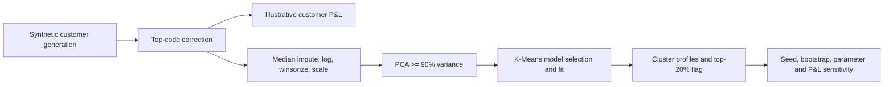
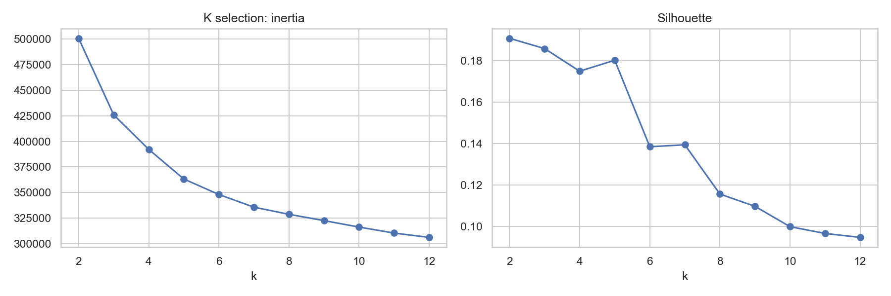
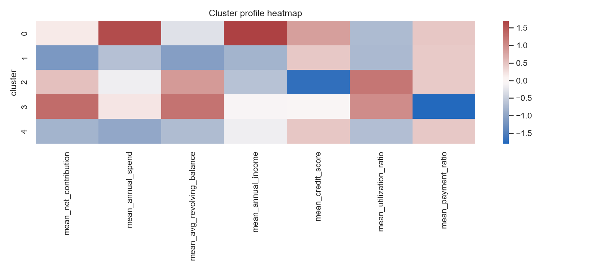
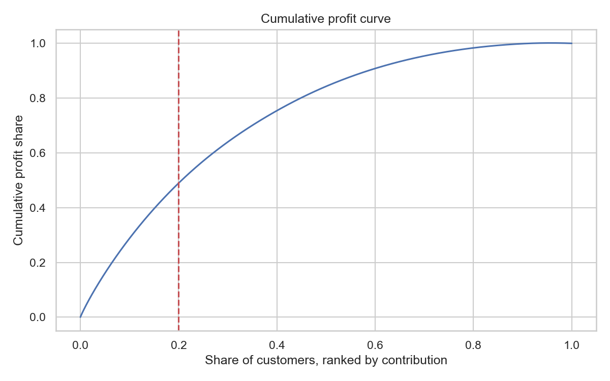
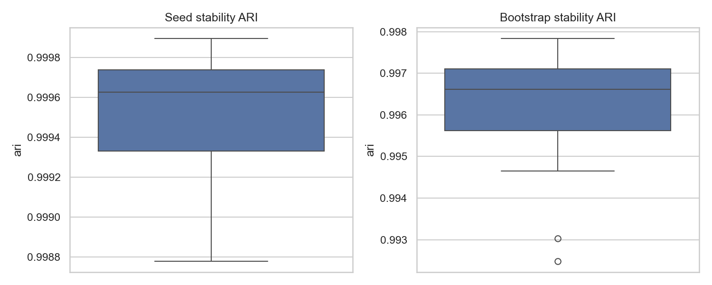

[](https://github.com/Sritzz-3/amex-profitability-segmentation/actions/workflows/ci.yml) [](LICENSE)

# AmEx Strategy Challenge | Profitability Segmentation Model

This project generates 120,000 synthetic credit-card customer records across 23 behavioral and financial features, then segments them with PCA and K-Means. It profiles each segment with an illustrative customer P&L and flags the top 20% of customers by modeled net contribution.

> **Synthetic data disclaimer:** The challenge data is proprietary and unavailable. Every customer and financial value in this repository is synthetic, generated from seeded distributions. Reported numbers illustrate the method only and are not real AmEx results.

## Problem
Identify groups of credit-card customers with distinct behavioral and profitability profiles, and flag the most profitable fifth of customers for strategic study. P&L components are excluded from clustering inputs to avoid target leakage.

## Method



### P&L equation

`net contribution = interest income + interchange income + fee income − rewards cost − credit loss − cost of funds − servicing cost − acquisition cost amortized`.

Rates, PD coefficients, payment adjustment, component noise levels and other P&L assumptions are centralized in `config.yaml`. Expected credit loss is modeled as balance × a score/late-payment/utilization-based PD × LGD. Components include multiplicative noise in the generated input data; the pipeline recalculates P&L consistently from the feature definitions.

### Censoring correction

Three inputs are top-coded at configured reporting caps. A generalized Pareto tail fitted to the uncensored upper tail estimates the conditional mean above each cap, bounded by a fitted 99.9th percentile. Original values and censor flags remain available; corrected values are added in separate columns.

## Run

Requires Python 3.10 or newer.

```bash
make setup
make all
# Or: .venv/bin/python -m src.run_pipeline --n-customers 120000 --seed 42
```

The default generator produces 120,000 records and 23 modeling features. An explicit smaller count is supported for smoke runs. Outputs are written under `outputs/`; data is regenerated under `data/`.

**Reproducibility:** Python 3.11.18, seed 42; the default 120,000-customer pipeline run took 94.92 seconds on this workspace.

## Results

### Key findings

On the 120,000-customer synthetic run, PCA retained 14 components and 90.41% of variance; k=5 had the best silhouette within the business range of 4–8, with a silhouette score of 0.1802. The top 20% by net contribution generated 48.96% of total portfolio profit. Segment assignments were reproducible across refits (mean seed ARI 0.9995, SD 0.0004; mean bootstrap ARI 0.9962). Under ±10% and ±20% P&L assumption changes, top-20% membership Jaccard ranged from 0.9498 to 0.9981, while Spearman contribution rank correlation ranged from 0.9982 to 1.0000; these results describe synthetic data only.

| Metric | Run result |
|---|---:|
| Customers / modeling features | 120,000 / 23 |
| Selected k | 5 |
| PCA components / variance retained | 14 / 90.41% |
| Silhouette | 0.1802 |
| Mean seed ARI (10 seeds; SD) | 0.9995 (0.0004) |
| Mean bootstrap ARI (20 resamples) | 0.9962 |
| Top-20% share of net contribution | 48.96% |

## Segment profiles

| Segment | Customers (count; portfolio share) | Mean net contribution ($/year) | Share of portfolio profit | Share of flagged top 20% |
|---|---:|---:|---:|---:|
| Premium Spenders | 39,603 (33.00%) | $1,157.07 | 35.74% | 27.66% |
| Low-Engagement Transactors | 26,972 (22.48%) | $241.77 | 5.09% | 0.66% |
| High-Risk Revolvers | 11,497 (9.58%) | $1,392.40 | 12.49% | 12.88% |
| Profitable Revolvers | 27,334 (22.78%) | $1,929.51 | 41.13% | 57.14% |
| Dormant Balances | 14,594 (12.16%) | $488.14 | 5.56% | 1.65% |

Profitable Revolvers and Premium Spenders contribute 76.87% of total portfolio profit and account for 84.80% of the flagged top-20% customers. All five segments have positive mean net contribution in this modeled P&L, so none is loss-making on average in this run. High-Risk Revolvers describes a feature profile, not a negative profitability result.

### Interpreting the results

The silhouette score of 0.1802 is low-to-moderate and indicates overlap in feature space, which is expected with behavioral customer data. The model chooses k=5 because it has the best silhouette among the business-range candidates k=4–8; the high ARI scores show the partition is reproducible, not that the clusters are well separated. Across ±10% and ±20% P&L assumption changes, the top-20% membership Jaccard ranged from 0.9498 to 0.9981, and contribution rank correlations remained between 0.9982 and 1.0000. This robustness is expected because proportional changes mostly rescale P&L components; it does not demonstrate stability on real data.

## Key figures










## Sensitivity

On this seeded run, seed stability was high (mean ARI 0.9995, SD 0.0004) and bootstrap stability was also high (mean ARI 0.9962); per-cluster bootstrap Jaccard means ranged from 0.9958 to 0.9983. At the selected k=5, PCA targets from 80% to 95% retained ARI from 0.9824 to 0.9875 against the baseline. Across ±10%/±20% P&L assumption changes, the top-20% membership Jaccard ranged from 0.9498 to 0.9981, with Spearman rank correlation from 0.9982 to 1.0000. Naive capping versus Pareto correction had 0.9992 overlap. Interchange rate was the most influential tested assumption for flagged membership. These are computed synthetic results and do not establish stability on real customer data; inspect `outputs/tables/` for each scenario.

## Repository structure

```text
.github/
└── workflows/ci.yml
.gitignore
LICENSE
Makefile
README.md
config.yaml
pytest.ini
requirements.txt
src/
├── __init__.py
├── __main__.py
├── censoring.py
├── config.py
├── data_generator.py
├── modeling.py
├── pnl.py
├── preprocessing.py
├── profiling.py
├── run_pipeline.py
├── sensitivity.py
└── visualization.py
tests/
├── test_censoring.py
├── test_modeling.py
├── test_pipeline_smoke.py
└── test_pnl.py
data/
├── processed/.gitkeep
├── raw/.gitkeep
└── sample/
    ├── .gitkeep
    └── customers_sample.csv
notebooks/01_walkthrough.ipynb
outputs/
├── figures/
│   ├── .gitkeep
│   ├── cluster_heatmap.png
│   ├── contribution_boxplot.png
│   ├── k_diagnostics.png
│   ├── pca_clusters.png
│   ├── pca_scree.png
│   ├── profit_curve.png
│   ├── sensitivity_tornado.png
│   └── stability_ari.png
├── models/.gitkeep
└── tables/
    ├── .gitkeep
    ├── bootstrap_cluster_jaccard.csv
    ├── bootstrap_stability.csv
    ├── censoring_correction.csv
    ├── cluster_profiles.csv
    ├── hyperparameter_sensitivity.csv
    ├── k_diagnostics.csv
    ├── pca_loadings.csv
    ├── pnl_sensitivity.csv
    ├── run_summary.csv
    ├── seed_stability.csv
    ├── sensitivity_summary.txt
    └── top20_cluster_lift.csv
```

Generated raw and processed data, `customer_scored.csv`, and serialized model files are ignored by Git. The pipeline creates model files locally in `outputs/models/`; no models or large datasets are committed.

## Limitations and future work

Synthetic archetypes and simplified annual economics cannot reproduce real customer behavior, contractual terms, regulatory constraints, or portfolio accounting. The Pareto tail is a modeling assumption. Validate with governed production data, calibrated loss and funding curves, time-based stability tests, and business review before any decision use.
